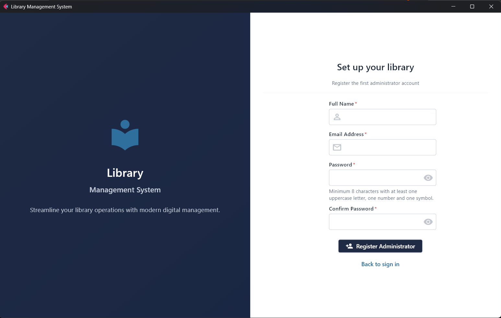
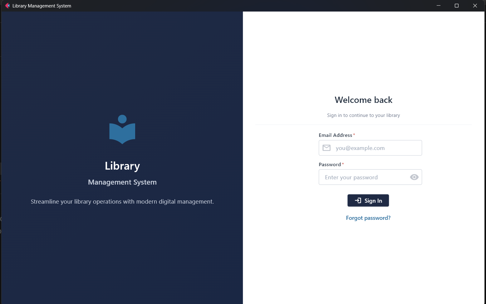
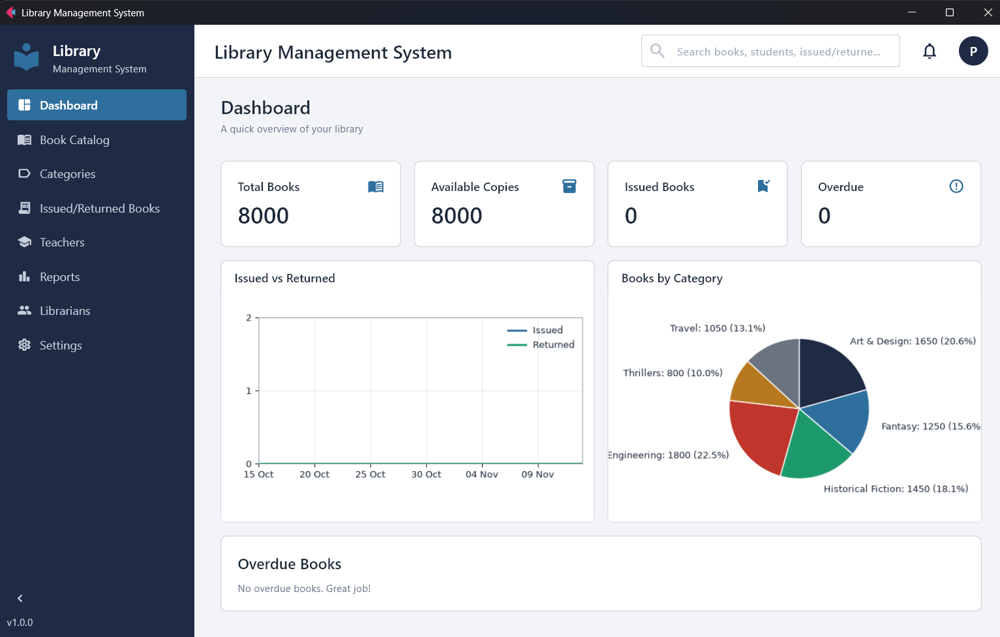
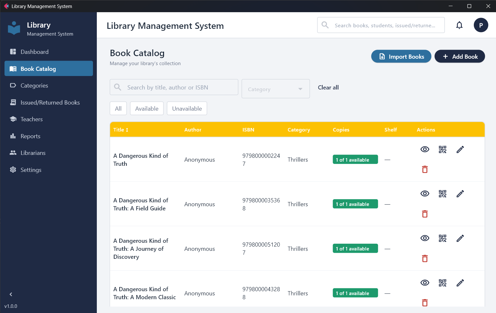
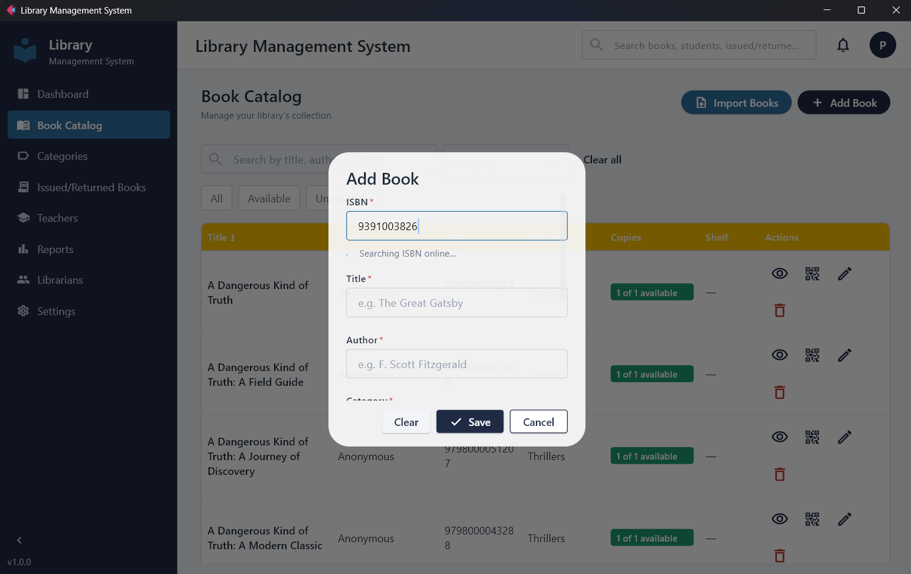
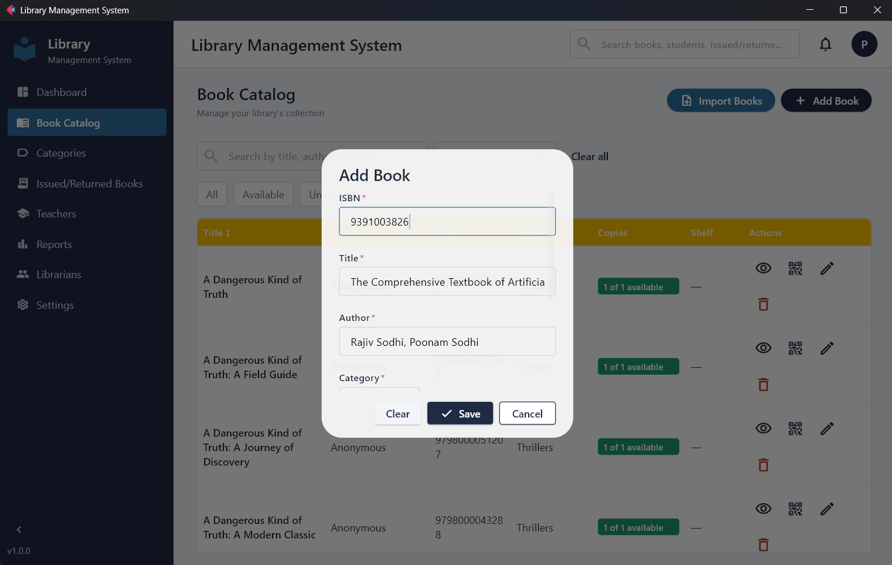
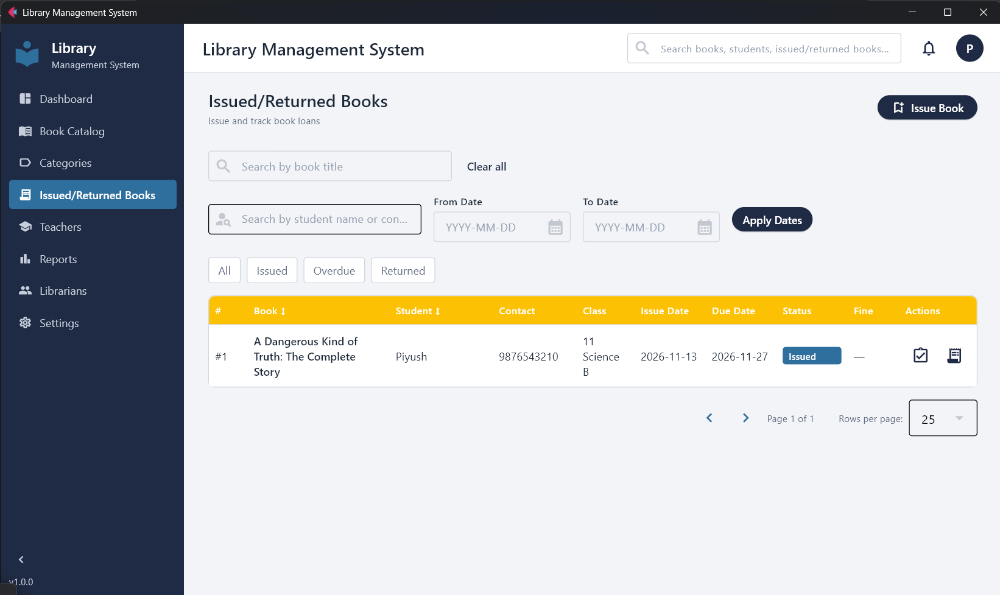
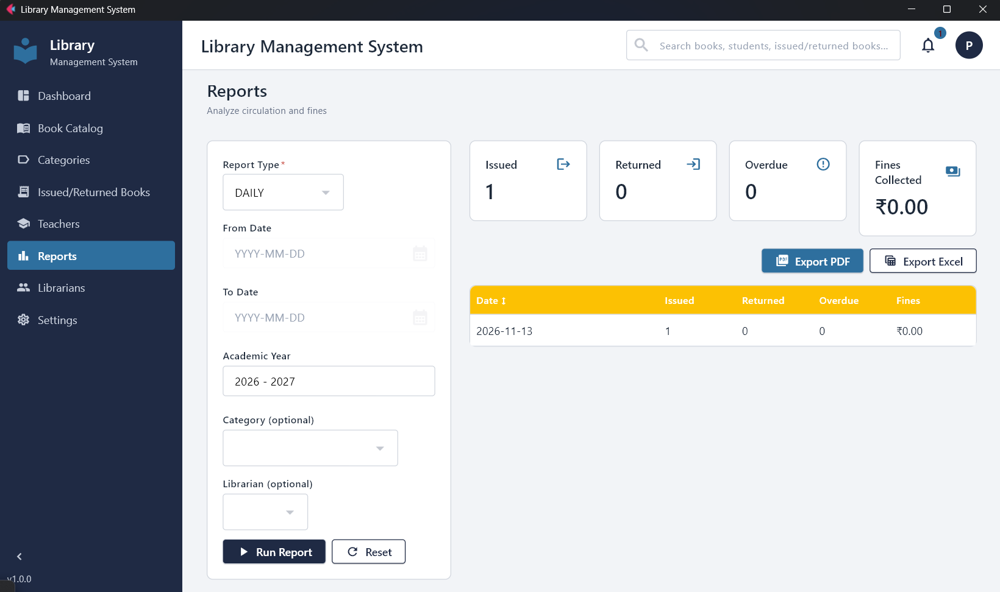
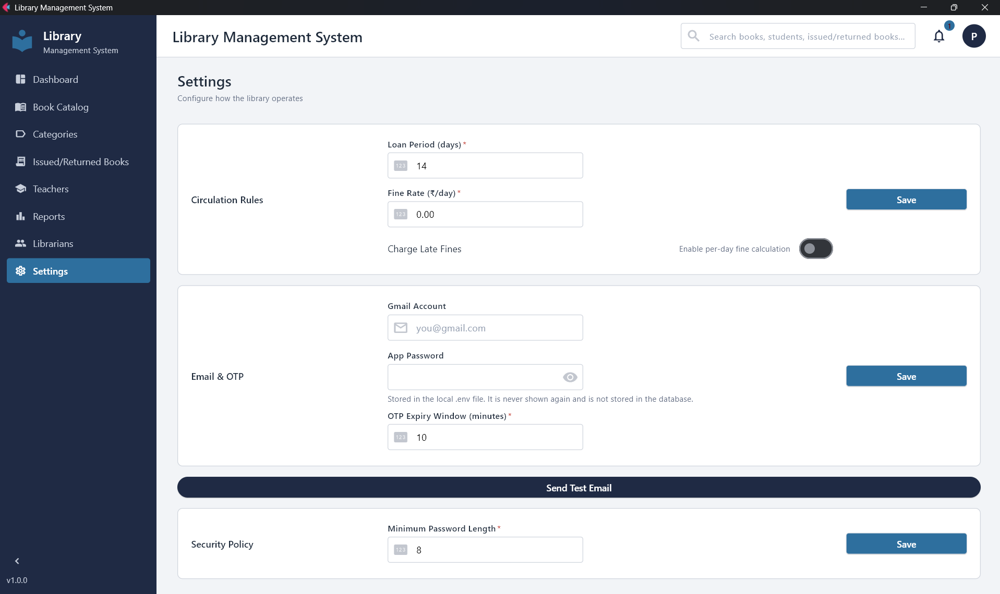

# Library Management System (LMS)

A desktop application for schools and small libraries to manage their book collections, circulation, and staff — built with **Python** and **Flet**, backed by **MySQL**.

- **Roles:** Administrator and Librarian, with role-based access on every screen
- **Data:** MySQL via XAMPP, schema managed by Alembic migrations (auto-runs on first launch)
- **Reports:** Daily / Weekly / Monthly / Yearly / Custom, exported to PDF and Excel
- **Platforms:** Windows (installer available), runs in desktop or browser mode

---

## Table of contents

1. [Features at a glance](#features-at-a-glance)
2. [Screenshots](#screenshots)
3. [Quick start (run from source)](#quick-start-run-from-source)
4. [Using the app](#using-the-app)
5. [Configuration (.env)](#configuration-env)
6. [Project structure](#project-structure)

---

## Features at a glance

### Authentication & security
- **First-run administrator registration** — the very first launch creates the admin account; every later launch goes to Login
- **Login with lockout** — configurable max attempts, lockout window and duration (`login_max_attempts`, `login_lockout_minutes`, `login_window_minutes`)
- **Password rules** — configurable minimum length, bcrypt-hashed storage
- **Forgot password via OTP** — a single-use, expiring OTP (default 10 min) is emailed through Gmail SMTP; account existence is never revealed to the requester
- **Role-based authorization** — every service method is guarded by `require_role`; Administrators manage Librarians and Settings, Librarians are excluded from both

### Dashboard
- Key library metrics at a glance: totals, issues/returns, overdue counts
- Charts (matplotlib, headless `Agg` backend) for activity trends

### Book Catalog
- **ISBN as the primary key** with ISBN-10/ISBN-13 checksum validation
- **Online ISBN autofill** in the Add Book dialog — Open Library first, then Google Books, then the Indian national ISBN portal; fully offline-safe (any failure falls back to manual entry, no API key needed)
- **QR code label generation** per book (printable labels)
- **Bulk import** from CSV, Excel or JSON with smart column detection, per-row validation preview, duplicate-ISBN skipping, and automatic creation of missing categories
- Search by title / author / ISBN, filter by category; global search bar routes ISBN-shaped queries to books, digit-only queries to transactions, and text to titles/names/shelf codes

### Categories
- Create, rename and manage categories; suggested automatically during ISBN lookup

### Circulation (Issued / Returned Books)
- Issue and return books, track who holds what
- Loan period and overdue/fine rules driven by Settings (`loan_period_days`, `fine_enabled`, `fine_rate_per_day`)
- Available-copy counting is maintained transactionally (never goes negative)

### Teachers
- Registry of teachers plus their book issues (separate issue flow from students/staff)

### Reports
- Report types: **Daily, Weekly, Monthly, Yearly, Custom** date range
- Preview in-app, then export to **PDF** (ReportLab) or **Excel .xlsx** (OpenPyXL) with styled headers and totals

### My Activity
- Each Librarian sees their own issue/return history (Administrators don't see this tab — it is per-user)

### Librarians (Administrator only)
- Add, deactivate and manage Librarian accounts

### Settings (Administrator only)
- Loan period, fines, OTP expiry, SMTP host/port, password policy, login lockout — all stored in the database `settings` table with seeded defaults

### Notifications
- In-app notification center (latest 50) with unread badge in the header

---

## Screenshots

**Login & first-run setup**





**Dashboard**



**Book Catalog & ISBN autofill**



Add Book dialog — online ISBN lookup in progress, then the autofilled result:





**Issue / Return**



**Reports (PDF / Excel export)**



**Settings (Administrator)**



---

## Quick start (run from source)

**Prerequisites:** Python 3.11+, XAMPP (MySQL running on port 3306).

```bash
# 1. Install dependencies
pip install -r requirements.txt

# 2. Configure environment
copy .env.example .env        # Windows (or cp on other OS)
#    then edit .env — see Configuration below

# 3. Run (desktop mode; falls back to web mode automatically)
python run.py
```

Alternatives:

```bash
start.bat          # same as python start.py — sets SSL certs, launches flet
python start.py    # direct
flet run app/main.py   # plain flet CLI (flet.cmd wraps it with SSL fix)
```

On first launch the app **creates the database and runs Alembic migrations automatically**, then shows the **Administrator registration** screen. Later launches show **Login**.

Logs: `lms.log` in the working directory (and `%LOCALAPPDATA%\LibraryManagementSystem\lms.log` in the packaged app).

---

## Using the app

| Task | How |
| --- | --- |
| Register first admin | First launch → fill the registration form |
| Add a book | Book Catalog → **Add Book** → type ISBN for autofill (or enter manually) |
| Bulk-import a catalog | Book Catalog → **Import** → CSV / Excel / JSON → review preview → commit |
| Print QR labels | Book Catalog → book row → **QR label** |
| Issue a book | Transactions → **Issue** → pick book + borrower |
| Return a book | Transactions → **Return** → pick the active loan |
| Run a report | Reports → choose type (Daily…Custom) → **Preview** → **Export PDF** / **Export XLSX** |
| Reset a password | Login → **Forgot password** → enter email → OTP arrives by email → set new password |
| Change loan/fine rules | Settings (Administrator) |
| Manage librarians | Librarians (Administrator) |
| Global search | Header search bar — type ISBN, contact number, title, author or shelf code |

**Roles:** Administrator sees everything except *My Activity*; Librarians see everything except *Librarians* and *Settings*.

---

## Configuration (.env)

Copy `.env.example` to `.env` and fill in real values. **Never commit `.env`** (it is git-ignored).

| Key | Meaning | Default |
| --- | --- | --- |
| `DB_HOST` | MySQL host | `localhost` |
| `DB_PORT` | MySQL port | `3306` |
| `DB_NAME` | Database name (auto-created) | `lms_db` |
| `DB_USER` | MySQL user | `root` |
| `DB_PASSWORD` | MySQL password | *(empty — XAMPP default)* |
| `SMTP_HOST` | SMTP server for OTP emails | `smtp.gmail.com` |
| `SMTP_PORT` | SMTP port | `587` |
| `SMTP_USERNAME` | Gmail address | — |
| `SMTP_APP_PASSWORD` | Gmail **App Password** (not your login password) | — |
| `APP_ENV` | `development` / `production` | `development` |

> **Gmail App Password:** create one at https://myaccount.google.com/apppasswords (requires 2-Step Verification). Forgot-password OTPs won't send without it.

---

## Project structure

```
app/
├── core/            # config, database, security, logging, exceptions
├── models/          # SQLAlchemy models (Book, User, Transaction, …)
├── repositories/    # data-access layer (+ interfaces)
├── services/        # business logic (+ interfaces) — every method role-guarded
├── reporting/       # PDF (ReportLab) and Excel (OpenPyXL) exporters
├── presentation/
│   ├── screens/     # auth, dashboard, books, categories, transactions,
│   │                # teachers, reports, my_activity, librarians, settings
│   ├── shared_components/  # shell (sidebar/header), toasts, dialogs
│   └── theme/       # colors and styling
├── utils/           # validators (ISBN, dates, …)
└── assets/          # images bundled with the app

migrations/          # Alembic migrations (0001_baseline, …)
tests/               # unit/ and ui/ test suites
packaging/           # PyInstaller spec, Inno Setup script, build scripts
docs/                # screenshots (VOL*.docx design docs kept out of git)
run.py / start.py / start.bat / flet.cmd   # launchers
```

**Stack:** Flet 0.86.4 · SQLAlchemy 2 · Alembic · PyMySQL · bcrypt · ReportLab · OpenPyXL · matplotlib · qrcode · python-dotenv
